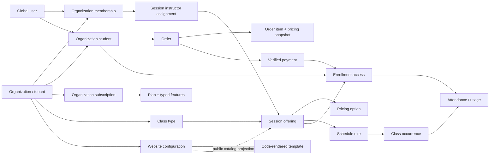

# Domain model

Status: architecture baseline; implementation proceeds by milestone. This document covers the complete target domain, including modules that are not implemented in the initial foundation. Source: `progressrooms-script.md`, sections 1–125. Individual teachers and studios share the same model.

## Bounded domains and ownership

| Domain | Aggregate / entities | Responsibility and invariants |
| --- | --- | --- |
| Identity | `users`, `user_auth_methods`, `user_sessions`, OTP challenges | One verified global identity per normalized email; credentials and sessions do not belong to an organization. Authentication does not confer an organization role. |
| Platform administration | `platform_admins`, `audit_logs` | Explicit platform role; audited administrative endpoints. No silent bypass of tenant checks. |
| Organization | `organizations`, `organization_members`, `organization_students`, `organization_settings` | Organization is the tenant. A global user may be a member or student in many organizations. Membership roles are OWNER, ADMIN, INSTRUCTOR; student association is separate. An owner may teach through the same membership. |
| SaaS billing | `plans`, `plan_features`, `organization_subscriptions` | Platform sells subscriptions to organizations. Typed feature entitlements and quota checks are centralized. Starter trial is 30 days; Progress AI is coming soon and cannot be purchased. |
| Catalog | `class_types`, `sessions`, `session_instructors`, `session_pricing`, `session_requirements` | Class type groups offerings; a session is a product/program, not a dated event. Pricing snapshots define purchased access. Instructors must be active members of the same organization. |
| Scheduling | `session_schedule_rules`, `class_occurrences`, `class_occurrence_changes` | Local recurrence rules produce bounded UTC instants. Original occurrence times remain immutable; actual times may change with history. Generation is idempotent. |
| Student commerce | `orders`, `order_items`, `payment_attempts`, `payments`, `refunds`, `payment_webhook_events`, `organization_payment_accounts` | Student purchases belong to one organization. Integer minor-unit amounts and one currency per order. Provider-verified captured payments activate access exactly once. Separate from SaaS billing. |
| Access | `session_enrollments`, `attendance_records` | Enrollment ties an organization student to a session and purchased access. Attendance consumption is atomic, reversible by a tracked correction, and cannot happen twice. |
| Website | `website_templates`, `organization_websites`, `organization_domains`, `media_assets` | Public SSR reads approved public content; advanced websites select code-rendered, versioned templates with validated configuration. No arbitrary HTML. |
| Integration | `organization_integrations`, occurrence meeting metadata | Provider adapters hold encrypted organization-scoped credentials. Join URLs are private resources. Zoom is the initial planned provider. |
| Notifications / operations | `notifications`, `notification_preferences`, `audit_logs` | Business events are persisted with the transaction, delivered asynchronously and deduplicated. Audit and financial history are retained. |

## Relationships and boundaries

`users`, plans, templates, and platform administrators are global. Business children carry `organization_id`. Every tenant parent exposes a unique `(organization_id, id)` key; children use composite foreign keys so a valid session UUID from another tenant cannot be attached accidentally. A UUID is an identifier, never authorization. Exact columns, keys and cardinality are defined in `../03-database/schema.md` and `../03-database/er-diagram.md`.

A solo business creates one organization, one OWNER membership and instructor capability for that same member. Do not create a duplicate global user or force duplicate membership rows. A studio creates additional memberships and instructor assignments. The same user can be an owner at organization A, instructor at B, and student at C without role leakage.

## Lifecycle rules

| Entity | Lifecycle and rules |
| --- | --- |
| Organization | ACTIVE → SUSPENDED; soft deletion removes public access while preserving history. Slugs are normalized, unique and checked against reserved routes. |
| Membership | INVITED → ACTIVE → SUSPENDED / REMOVED. The final active owner cannot be removed without a transactional ownership transfer. Invitation support follows foundation. |
| Subscription | TRIAL → ACTIVE / EXPIRED; ACTIVE → PAST_DUE / CANCELLED / SUSPENDED. Entitlements also evaluate time boundaries, not just status strings. Keep old subscription periods. |
| Session | DRAFT → ACTIVE → ARCHIVED. Visibility PUBLIC / PRIVATE is independent of status; only active public, entitled sessions appear in discovery. |
| Occurrence | SCHEDULED → IN_PROGRESS → COMPLETED; cancellation and rescheduling preserve original times and append change history. Cancelled events cannot be joined or consume credits. |
| Order | PENDING → PAYMENT_PENDING → PAID; failed attempts can be retried without rewriting the financial snapshot. Refund state follows verified refund results. |
| Enrollment | PENDING → ACTIVE → PAUSED / EXPIRED / COMPLETED / CANCELLED. A paid order item grants access once. Renewal records a new paid period or grant; never overwrites historical purchases. |
| Website | DRAFT → PUBLISHED; preview is authenticated. Publish atomically advances a validated version. Downgrade retains private advanced configuration while public rendering falls back to the permitted default. |

## Access and money

An enrollment references `organization_student_id`, not a second student identity. Initial access types are DATE_RANGE, NUMBER_OF_CLASSES, PROGRAM_DURATION and UNLIMITED. Access intervals are half-open `[starts_at, ends_at)`; a class requires valid access at its actual start time. Class packages also require a positive remaining count. Monthly initial access means an explicitly purchased duration, not an implied auto-renewing student subscription. Pricing must clearly identify 30-day access versus calendar-month semantics.

Orders contain immutable name, price, tax, currency and access-policy snapshots. Historical orders must remain intelligible when a teacher changes session pricing. Initial purchasable type is SESSION_PRICING; use concrete foreign keys for supported items rather than an unchecked polymorphic ID. Future packages or digital products require a migration and validated fulfillment handler.

Payment success, order transition, access grant, notification creation and audit event form one database transaction after provider verification. Provider calls take place outside long-running database locks and use stable idempotency/reconciliation identifiers. Never activate an enrollment from a browser success callback.

## Time, consistency and growth

Persist instants as PostgreSQL `TIMESTAMPTZ`; retain IANA timezone and wall-clock fields on recurrence rules. Resolve daylight-saving ambiguity explicitly. Generate a rolling 90-day horizon, with a unique rule/original-start key. Record changes instead of rewriting original occurrence identity.

Keep transactional responsibilities inside domain services. API routers validate contracts and delegate; Next.js renders and coordinates interactions without owning pricing, permissions or access decisions. Start with a modular FastAPI service and PostgreSQL, then separate workers for schedule generation, notifications and meetings when those phases begin. Do not introduce microservices merely to match the conceptual boundaries.

## Architecture decisions that constrain implementation

1. Both repositories share this documentation baseline; backend owns schema and API truth, frontend consumes the contract.
2. Server RBAC and tenant filters apply to each resource; database composite keys are independent integrity protection.
3. Plan entitlements are data-driven; frontend feature visibility is advisory, backend enforcement is mandatory.
4. Public SSR uses a dedicated minimal projection without student PII, internal notes, meeting URLs or payment data.
5. Financial, access and audit records are retained; important mutable catalog entities support soft deletion.
6. Future AI, custom domains, WhatsApp, automatic subscription billing and marketplace settlement are reserved architecture, not implemented features.

## Baseline acceptance checks

The schema must reject cross-tenant session assignments, duplicate occurrence generation, duplicate provider event IDs and duplicate fulfillment. A repeated captured payment must grant one enrollment. Repeated attendance must consume one credit. Organization creation must atomically create its owner membership and Starter trial. No role can be inferred from an email address. Public serializers must not contain join URLs or student records.
