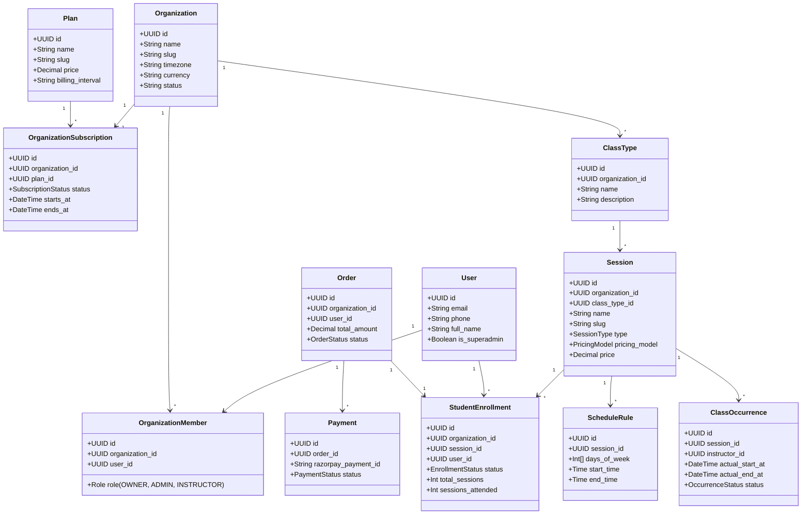

# ProgressRooms Domain Model

## 1. Domain Entities Overview

ProgressRooms is an industry-agnostic multi-tenant operating system for businesses offering scheduled instruction.

## 2. Multi-Tenant Hierarchy
1. **Platform**: Governed by platform superadmins.
2. **Organization**: Multi-tenant boundary. Represents an individual teacher business or a multi-teacher studio. Every organization has an Owner and optional Admins/Instructors.
3. **Session & Classes**: Group classes, 1-on-1 sessions, workshops, and courses.
4. **Occurrences**: Concrete, scheduled class instances derived from recurrence rules.
5. **Students & Commerce**: Students enroll and make payments via Razorpay. Access is tracked via time-windows (monthly) or session credits (package).
