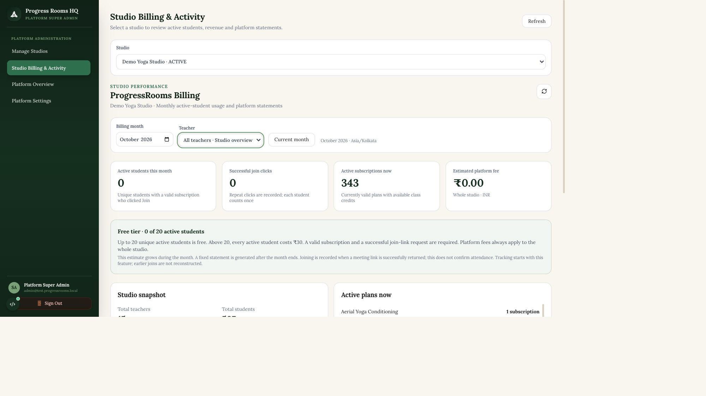
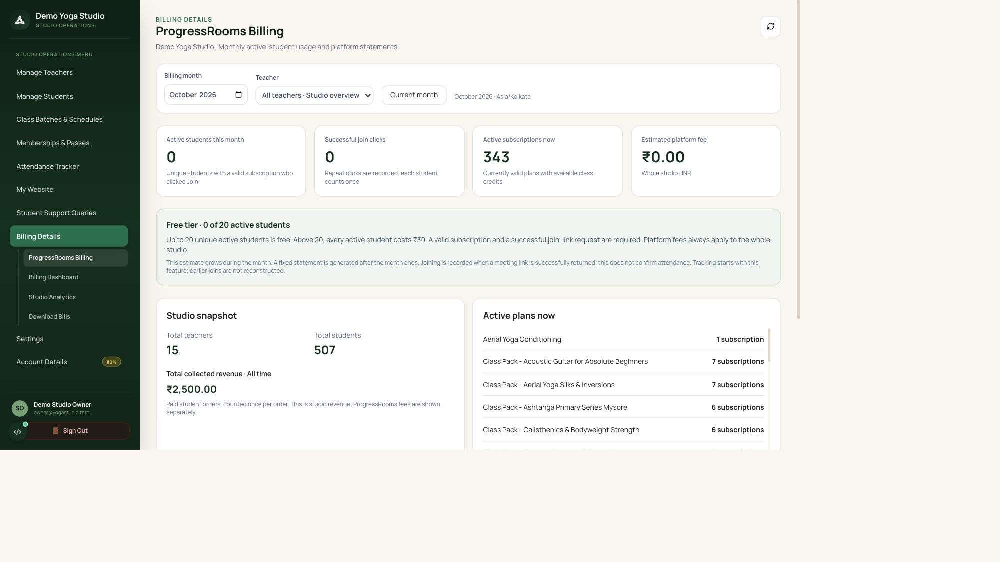
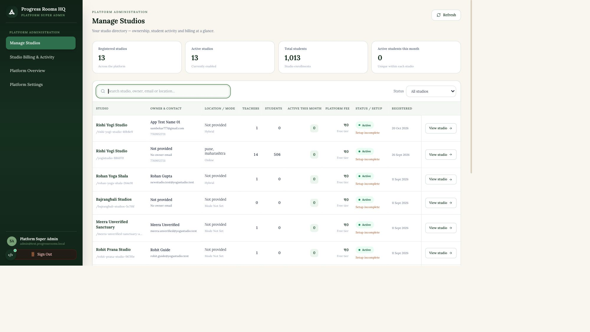
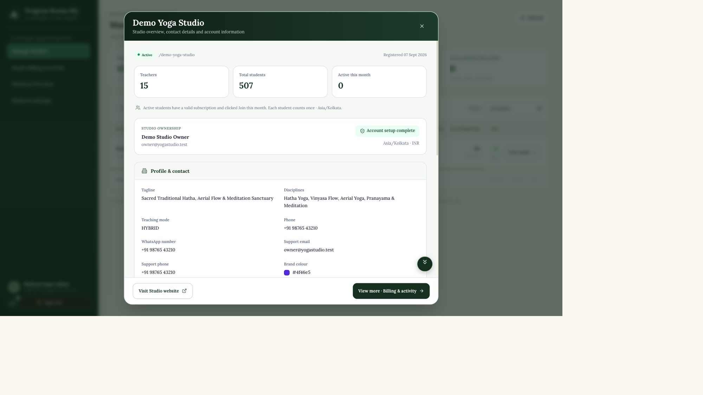

# Monthly active-student billing

Implemented on `dev` in the API and Web repositories. No branches were pushed.

## Rules

- A student qualifies when an authenticated student successfully requests a class meeting link with an active, currently valid subscription and available class credits.
- Count unique student accounts per studio per calendar month, using the studio's timezone at the time of the click. The same student can count independently in different studios.
- Keep every qualifying click for auditing. Multiple clicks, classes, subscriptions and teachers do not multiply the studio's active-student count.
- Up to and including 20 active students is free. Above 20, charge ₹30 for **every** active student: 21 = ₹630, 50 = ₹1,500. This follows the original request's wording; charging only students above the threshold would be a different rule.
- Paused, expired, future-dated or exhausted subscriptions and failed meeting-link requests do not qualify. Host/staff joins and manually marked attendance do not qualify.
- Later expiry, cancellation or teacher reassignment does not remove recorded activity. The teacher responsible for each join is snapshotted separately.
- Tracking begins with this feature. Historical attendance cannot establish historical join clicks and is not backfilled.

## Billing lifecycle

The current month is a live estimate. Completed months containing qualifying events become persisted statements with frozen counts, threshold, rate, INR amount and generation time. Months without recorded events have no statement and no fee.

Generation runs on the next qualifying join, billing-dashboard request, or existing `/communication/run-engine-cycle` invocation. Deployments requiring generation at a precise time must schedule the existing engine cycle; the API does not introduce a separate always-running scheduler. A unique database constraint and studio row lock prevent concurrent requests from creating duplicate monthly statements. Join timestamps are captured after acquiring the lock, avoiding late inserts into a closed month.

Statements represent platform usage charges. Automatic payment collection, payment status, tax invoice issuance and due/overdue reminders are outside this change.

## Dashboard behavior

- Studio: **Billing Details → Progress Rooms Billing** opens active-student usage, current estimate, teacher filter and monthly statement history. Existing student subscription billing, exports and analytics remain available.
- Super admin: **Manage Studios** is a studio directory. Selecting a studio opens its profile, contact, address, legal and bank details, teacher/student counts and current-month active-student count. Teacher/student rosters are not returned by this profile endpoint.
- **View more** opens **Studio Billing & Activity** with the studio already selected. Direct links retain the studio through the `studio` query parameter. No individual teacher is selected by default.
- The detailed view shows unique active students, successful clicks, current active subscriptions/plans, total teacher/student counts, paid-order revenue and generated platform statements.
- Teacher filters scope activity using the recorded teacher snapshot. Current plans and paid orders use current class assignments. Shared students/orders can appear in multiple teacher views; teacher totals must not be summed as studio totals.
- Multi-class passes count as one current subscription. Paid orders count once; revenue is grouped by currency rather than adding unlike currencies.
- Fees and statement history always remain studio-wide, including while a teacher filter is active. Revenue is clearly labeled all-time; active plans are explicitly current, regardless of the usage month selected.

## Storage and endpoints

Migration `026_active_student_billing` adds `student_join_events`, `student_join_teachers`, and `platform_invoices`.

- `GET /organizations/{org_id}/billing/progressrooms?month=YYYY-MM-01&teacher_id=…`: studio owners and super admin.
- `GET /admin/organizations/{org_id}`: super-admin-only studio profile and counts. Bank account details are available here; Zoom keys, OAuth tokens and payment credentials are excluded.
- `GET /admin/organizations/{org_id}/teachers`: optional teacher filters, including teaching studio owners.
- `GET /admin/organizations/{org_id}/progressrooms`: super-admin-only dashboard, including suspended studios.

Run `alembic upgrade head` in each target environment before deploying the API. The local development database has been upgraded to 026. Web and API must deploy together. No remote environment was modified.

## Verification

- Billing tests cover the 0/15/20/21/50 boundaries, repeated clicks, independent studios, teacher overlap, subscription expiry and credits, failed providers, month/leap-year boundaries, frozen statements, multi-class passes, paid-order revenue, access control and private-profile fields.
- Optional PostgreSQL tests (`BILLING_TEST_POSTGRES_URL`) verify simultaneous joins and concurrent statement generation using disposable schemas. All three passed locally, including concurrent reporting and joins against a shared pass.
- Migration upgrade/downgrade verified against a disposable PostgreSQL schema, then applied to the local development database.
- Production Web build, TypeScript and lint checks passed. Lint reports existing hook-dependency/image warnings.
- Full API suite found two unrelated existing test failures: `test_calendar_returns_start_instant_for_client_status_transition` (fixture lacks `full_description`) and `test_public_session_buying_information` (cancellation text expectation differs). All 51 focused billing/Zoom/communication/payment/class-package tests and all three PostgreSQL concurrency tests passed.
- Browser verified studio directory, profile popup, View more navigation, selected studio, default all-teachers scope, teacher filtering and owner Billing Details navigation.

## Studio directory and popup refinement — 23 October 2026

- Manage Studios now includes owner/contact, location/teaching mode, teacher/student counts, current-month active students, estimated platform fee, account status/setup, and registration date. Summary cards, contact/location search, status filtering and ten-row pagination make the directory easier to scan. Aggregate data is batched to avoid one query per studio; private bank details remain confined to the protected profile endpoint.
- The profile uses a wider dialog with padded content, separate detail cards, a fixed action footer and collapsed Zoom preferences. Existing dashboard font preferences are respected.
- **Visit Studio website** opens the published public page in a new tab. Studios without a published artifact, or inactive studios, show a disabled button and explanation rather than a broken link. Missing export storage does not prevent the studio profile loading.
- Verified the directory/search, revised popup and published Demo Yoga Studio website in the browser. All 12 focused API tests and TypeScript checks pass; lint passes with existing warnings.

