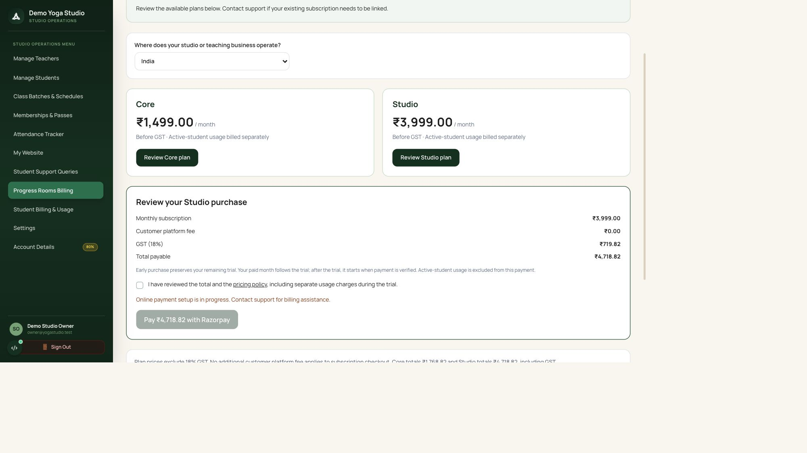

# SaaS trial and Razorpay billing — implementation handoff

Updated: 23 October 2026. Implemented locally on `dev`; nothing pushed or deployed. This document replaces the earlier design draft with the confirmed commercial rules and actual implementation.

## Confirmed customer pricing

| Monthly plan | Before GST | GST (18%) | Customer pays |
| --- | ---: | ---: | ---: |
| Core | ₹1,499.00 | ₹269.82 | ₹1,768.82 |
| Studio | ₹3,999.00 | ₹719.82 | ₹4,718.82 |

There is no additional customer platform/processing surcharge. Razorpay processing fees and GST on those fees are merchant settlement costs. The user's illustrative 2% settlement calculation is not an extra checkout line item or a guaranteed settlement amount.

Active-student usage is separate and remains chargeable during the subscription trial. For eligible Indian studios, teachers and students, up to 20 unique active students in a calendar month are free; above 20, **every** active student costs ₹30 before applicable tax (21 = ₹630). A qualifying event requires a valid student subscription when Join is clicked; repeated clicks count once per student/studio/month. Existing monthly boundaries use Asia/Kolkata.

International studios/teachers and students paying from outside India require a country-specific support quote. Country is declared, not inferred from IP or card data. Unknown historical country information also requires review; it is never silently assumed to be India. Usage statements remain separate from SaaS checkout and do not collect payment through this new subscription checkout.

## Customer experience

- Core/Studio selection survives registration and OTP verification. A verified new studio starts one 30-day subscription trial; retries cannot reset it. Solo teachers purchasing the platform register as studio owners. Invited teachers do not get another studio trial.
- **Progress Rooms Billing** is a primary owner menu item. It shows subscription state, plan cards, itemized price review, pricing-policy acknowledgment, payment status and payment history. Existing class-sales and active-student reporting remain under **Student Billing & Usage**.
- Indian buyers can review the exact server quote. Outside-India selection directs the buyer to support. Landing-page prices, registration, privacy/commercial notices and `/pricing-policy` disclose GST and chargeable trial usage.
- The payment window uses Razorpay Standard Checkout with a server-created Order. The public `razorpay.me/@sahillaxmanambekar` handle is not used as an API credential or an invented amount-query URL.
- Payment cancellation does not activate a plan. Callback, webhook and the **Check payment** action all use verified server fulfillment.
- Early payment preserves remaining trial time: the paid month follows the trial. Grace/late purchases start when verified. Same-plan renewals extend existing coverage and retain the calendar-month anchor. Active mid-period plan changes require support; there is no proration or recurring debit mandate.

## Trial lifecycle and access

Let T be successful verification; timestamps are stored in UTC and displayed locally.

| Interval | State | Behavior |
| --- | --- | --- |
| T to T+28 days | Trial | Normal studio access. |
| T+28 to T+30 | Trial ending | Warning on each fresh login and persistent deadline banner. |
| T+30 to T+33 | Grace | Warning that the trial ended and the restriction deadline is approaching. |
| At T+33 without paid coverage | Restricted | Billing, Settings and account recovery remain available; operational access is blocked when enforcement is enabled. |
| Verified paid coverage | Active | Access restored through the purchased period. |

The five-day warning window is elapsed time, not five login attempts. The UI reevaluates on focus, every minute and after payment; server checks are authoritative. Owners see purchase actions; teachers see contact-owner notices. Studio records are retained rather than deactivated/deleted.

The server guard covers organization operational routes, staff tenant resolution, student Join and purchases, Zoom operations, public studio sites and scheduling/reminder jobs. Public sites return a neutral unavailable response. Existing authorized superadmin inspection remains accessible. Pricing-tier feature/quota enforcement remains the existing plan subsystem; this work adds subscription-expiry enforcement rather than replacing every existing feature gate.

**Current rollout state:** `SAAS_ACCESS_ENFORCEMENT_ENABLED=false`. No new lockout is active locally. Existing subscriptions default to unmanaged/legacy and are not retroactively restricted. New verified registrations are managed. Enabling the flag affects managed subscriptions only; migrating existing accounts requires an explicit reviewed transition. The UI labels legacy accounts “Existing account”.

## Database and migration

Migration chain: `026_active_student_billing` → `027_saas_checkout` → `028_usage_pricing_region`.

| Storage | Implemented change |
| --- | --- |
| `organization_subscriptions` | Existing unique studio subscription reused; adds `saas_managed` (false for existing rows) and `trial_grace_ends_at`. Selected/effective tier uses existing `plan_id`; existing start/end/trial timestamps are reused. |
| `saas_checkouts` | Studio, purchaser, plan, status, exact integer-paise price/tax/fee snapshot, policy version, scoped client idempotency key, provider Key ID, unique order/payment IDs, paid timestamp, service-period timestamps and generated receipt reference. Positive total constraint. One unresolved order per studio is serialized by the studio row lock. |
| `saas_webhook_events` | Unique provider event ID, bounded signed payload, processing state and timestamp. Durable ingress supports provider retry. |
| `users.billing_country` | Optional two-letter country for student/teacher eligibility. Registration/profile and teacher forms support it. |
| `student_join_events.pricing_region` | Event-time India/international/unconfirmed snapshot. Historical unknown data stays unknown. Months with unresolved/international usage show “Contact support” instead of an automatic India-rate statement. Already issued statements remain frozen. |

Migration 027 creates missing Starter/Core/Studio catalog rows but preserves existing prices and does not overwrite plan features. Review the deployment's existing catalog and feature rows before launch. It does not create a second invoice/period ledger: checkout records hold the captured payment and service period for this initial manual-renewal flow. Receipt references in payment history are **not downloadable GST tax invoices**.

Both migrations were applied to the local database. PostgreSQL upgrade/downgrade verification ran in a disposable schema; no production database was changed. Do not downgrade financial tables containing real payments as an application rollback. Disable enforcement instead and preserve payment history.

## Payment integrity and endpoints

Routes below are prefixed with `/api/v1`:

- `GET /organizations/{org_id}/saas-billing/access`: authorized staff lifecycle state.
- `GET /organizations/{org_id}/saas-billing`: owner summary/catalog/history.
- `POST /organizations/{org_id}/saas-billing/quote`: server quote for eligible country/plan.
- `POST /organizations/{org_id}/saas-billing/checkouts`: owner-only order creation with idempotency key, reviewed expected total and accepted policy version. The server calculates the charge; the client amount is a stale-price check.
- `POST /organizations/{org_id}/saas-billing/checkouts/{id}/verify`: callback HMAC check plus provider payment fetch.
- `POST /organizations/{org_id}/saas-billing/checkouts/{id}/reconcile`: fetch order payments and apply a captured payment once.
- `POST /saas-billing/webhooks/razorpay`: dedicated raw-body signature-verified SaaS webhook.

Fulfillment checks stored order/account, full amount, currency, captured state and absence of refunds. Organization/checkout locks and unique payment IDs prevent concurrent callbacks/webhooks from extending coverage twice. Student-commerce and SaaS orders are kept separate; each webhook recognizes orders owned by the other flow without fulfilling them.

An uncertain order-creation timeout persists `UNKNOWN` and blocks another automatic payable order. Support must reconcile the provider receipt/order before clearing it. Callback/webhook loss can be recovered with Check payment when the order ID is known. Unknown webhook associations return a retryable response. There is no background reconciliation worker, support reconciliation UI, automated refund/chargeback adjustment or statutory tax-invoice generator in this change. Those require a follow-up before offering those operations as product features.

Official integration references: [Standard Checkout](https://razorpay.com/docs/payments/payment-gateway/web-integration/standard/integration-steps/), [Orders API](https://razorpay.com/docs/api/orders/create/), [webhook verification](https://razorpay.com/docs/webhooks/validate-test/).

## Required setup before activation

Server template: `progressrooms-api/.env.saas.example` (blank credentials, safe to track).

1. Configure actual Razorpay **test** Key ID/secret and a separate `SAAS_RAZORPAY_WEBHOOK_SECRET` in the API environment. Never put secrets in frontend variables, source code or chat. Existing local credentials are mock; checkout remains disabled.
2. Retain the confirmed configuration: GST 1800 basis points, customer platform fee 0 basis points/0 paise, GST-on-fee false. Configure automatic capture in the merchant account.
3. Configure a publicly reachable HTTPS webhook at `/api/v1/saas-billing/webhooks/razorpay`, subscribe to `payment.captured`, and use the same dedicated SaaS webhook secret on the API server. Retain the existing student-commerce webhook separately.
4. Run actual test-mode payment, cancellation, callback-loss and webhook-retry checks. Verify exact totals, one entitlement grant, renewal dates and Billing/Settings recovery. No real provider payment has been run yet; automated provider tests use stubs.
5. Review managed studio dates and existing catalog/features. Enable expiry enforcement only after payment recovery works. Plan a separate notified transition for legacy accounts; do not bulk reset their trials or paid dates.
6. Repeat merchant/environment configuration for production when authorized. No branch was pushed and no production setting was enabled in this work.

## Verification evidence

- Final focused API run: **62 passed** across SaaS, active-student billing, billing, communication and teacher Zoom tests.
- PostgreSQL checks: **5 passed**, including concurrent order creation, concurrent fulfillment and migration round-trip, using disposable schema fixtures.
- Full API run: **192 passed, 8 skipped, 2 existing unrelated failures**: `test_calendar_returns_start_instant_for_client_status_transition` (fixture lacks `full_description`) and `test_public_session_buying_information` (old cancellation-copy expectation).
- Web typecheck, lint and production build passed. Lint/build retain existing hook/image warnings. Temporary build output was removed. Final callback error-handling edits passed typecheck.
- Browser: Studio review displays ₹3,999 + ₹719.82 = ₹4,718.82; online payment is visibly disabled while credentials are missing. No payment or policy acknowledgment was submitted.

