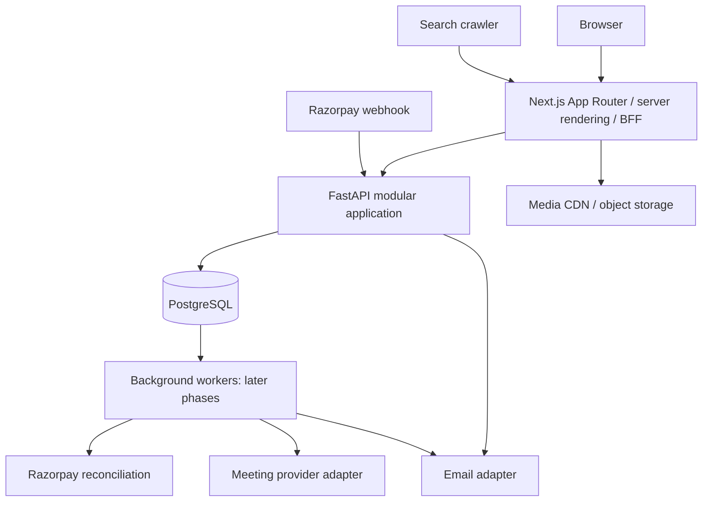

# System architecture

Status: agreed target architecture; only the foundation milestone is initially implemented.

The user requested two repositories. `progressrooms-web` owns Next.js, browser interaction, SSR and the HttpOnly-cookie BFF. `progressrooms-api` owns FastAPI, domain services, PostgreSQL migrations, authorization and jobs. Shared architecture documents live in the surrounding `progressrooms/docs` folder. Share contracts by versioned OpenAPI output rather than importing Python business code into the frontend.

## Request and trust boundaries

1. The browser calls same-origin Next.js handlers. The BFF reads a secure HttpOnly session cookie and forwards a bearer credential to FastAPI; it must never return that credential to browser JavaScript.
2. FastAPI authenticates the token against session state, resolves the organization from the route, validates active membership or student ownership, then checks role, resource tenant and entitlement.
3. Public SSR calls a public projection endpoint. Private dashboards use uncached authenticated responses. A shared cache cannot store membership-specific data.
4. Razorpay bypasses browser authentication through a dedicated signature-verified webhook boundary. A provider event identifies an existing server-created order; request-supplied organization IDs are not authority.

The service remains a modular monolith: routers → typed request/response models → application services → repositories/database. A service owns a transaction; repositories do not independently commit a multi-domain operation. Integration adapters translate provider payloads to internal commands. Enforce a stable error envelope and attach a request ID throughout logs.

## Infrastructure choices

PostgreSQL is the source of truth for identity, tenant relationships, financial state and materialized occurrences. Use a dedicated migration role and limited runtime role. Store media in object storage, reference metadata in PostgreSQL, and distribute published images through a CDN. Deploy API and frontend separately; retain one API contract version during rolling releases.

The initial foundation can use database-backed OTP throttling and direct delivery through an email adapter. Later recurring work uses a durable transactional outbox and workers. Choose a queue adapter when implementing jobs; do not describe an in-process background task as reliable delivery. Worker crashes and duplicate delivery are expected, so business operations use unique deduplication keys.

## Consistency decisions

Use row locks and uniqueness constraints for quota reservation, order fulfillment and attendance consumption. Keep provider network calls outside long database transactions. An outbox record commits with the business change, then a worker delivers and retries it. Use optimistic revision checks for website publishing and schedule edits to prevent overwriting another editor's work.

## Scale path

Begin with bounded indexed queries and connection pooling. Materialize the next 90 days of occurrences; use keyset pagination for large histories. Add read replicas, partition high-volume occurrence/audit data or separate workers only after measurement. Tenant isolation and durable identifiers should survive these changes without product-level rewrites. Avoid distributing one financial transaction across microservices at the outset.

## Observability and recovery

Log request ID, operation, duration, sanitized error code and relevant internal entity IDs. Never log OTPs, tokens, raw credentials or full student/payment payloads. Monitor API error rate, database pool pressure, webhook lag, unprocessed outbox age and scheduled occurrence coverage. Every state-changing operation must tolerate retry or document an idempotency requirement. Restore testing and failed-job replay are release operations described in deployment design.
