# Complete entity relationship model

This diagram is generated from the same validated inventory as the SQL. Every table and foreign key is included. `||` is exactly one, `o|` is zero or one, and `o{` is zero or more. PK/FK markers show key columns; relationship labels name every child column in composite foreign keys. A compound tenant foreign key binds the child to the same organization as its parent.

For readable review, the full entity list and the domain-focused relationship ledger follow the diagram. A nullable parent reference gives zero-or-one parent; a unique child foreign key changes one-to-many to one-to-zero-or-one. Some composite unique keys include extra columns and do not make the relationship one-to-one. Global notification/audit/outbox/webhook records may have no tenant. Uniqueness conditional on a partial index is documented in the schema rather than assumed by the diagram.

```mermaid
erDiagram
    users {
        uuid id PK
    }
    user_auth_methods {
        uuid id PK
        uuid user_id FK
    }
    user_sessions {
        uuid id PK
        uuid user_id FK
    }
    otp_challenges {
        uuid id PK
    }
    platform_admins {
        uuid id PK
        uuid user_id FK
    }
    organizations {
        uuid id PK
    }
    organization_members {
        uuid id PK
        uuid organization_id FK
        uuid user_id FK
    }
    organization_invitations {
        uuid id PK
        uuid organization_id FK
        uuid invited_by FK
        uuid accepted_by FK
    }
    organization_students {
        uuid id PK
        uuid organization_id FK
        uuid user_id FK
    }
    organization_settings {
        uuid id PK
        uuid organization_id FK
    }
    plans {
        uuid id PK
    }
    plan_features {
        uuid id PK
        uuid plan_id FK
    }
    organization_subscriptions {
        uuid id PK
        uuid organization_id FK
        uuid plan_id FK
    }
    organization_subscription_history {
        uuid id PK
        uuid organization_id FK
        uuid subscription_id FK
        uuid plan_id FK
        uuid changed_by FK
    }
    media_assets {
        uuid id PK
        uuid organization_id FK
        uuid uploaded_by FK
    }
    class_types {
        uuid id PK
        uuid organization_id FK
    }
    sessions {
        uuid id PK
        uuid organization_id FK
        uuid class_type_id FK
        uuid cover_image_id FK
    }
    session_instructors {
        uuid id PK
        uuid organization_id FK
        uuid session_id FK
        uuid organization_member_id FK
    }
    session_pricing {
        uuid id PK
        uuid organization_id FK
        uuid session_id FK
    }
    session_requirements {
        uuid id PK
        uuid organization_id FK
        uuid session_id FK
    }
    session_schedule_rules {
        uuid id PK
        uuid organization_id FK
        uuid session_id FK
    }
    organization_integrations {
        uuid id PK
        uuid organization_id FK
    }
    class_occurrences {
        uuid id PK
        uuid organization_id FK
        uuid session_id FK
        uuid schedule_rule_id FK
        uuid integration_id FK
    }
    class_occurrence_changes {
        uuid id PK
        uuid organization_id FK
        uuid class_occurrence_id FK
        uuid changed_by FK
    }
    organization_payment_accounts {
        uuid id PK
        uuid organization_id FK
    }
    orders {
        uuid id PK
        uuid organization_id FK
        uuid organization_student_id FK
    }
    order_items {
        uuid id PK
        uuid organization_id FK
        uuid order_id FK
        uuid purchasable_id FK
        uuid pricing_id FK
    }
    payments {
        uuid id PK
        uuid organization_id FK
        uuid organization_student_id FK
        uuid order_id FK
        uuid payment_account_id FK
    }
    payment_attempts {
        uuid id PK
        uuid organization_id FK
        uuid order_id FK
        uuid payment_id FK
    }
    refunds {
        uuid id PK
        uuid organization_id FK
        uuid payment_id FK
        uuid order_id FK
        uuid requested_by FK
    }
    payment_webhook_events {
        uuid id PK
        uuid organization_id FK
        uuid order_id FK
    }
    session_enrollments {
        uuid id PK
        uuid organization_id FK
        uuid organization_student_id FK
        uuid session_id FK
        uuid pricing_id FK
        uuid order_id FK
        uuid order_item_id FK
    }
    attendance_records {
        uuid id PK
        uuid organization_id FK
        uuid class_occurrence_id FK
        uuid session_id FK
        uuid organization_student_id FK
        uuid enrollment_id FK
        uuid marked_by FK
    }
    attendance_consumptions {
        uuid id PK
        uuid organization_id FK
        uuid attendance_record_id FK
        uuid enrollment_id FK
    }
    website_templates {
        uuid id PK
    }
    organization_websites {
        uuid id PK
        uuid organization_id FK
        uuid template_id FK
        uuid published_template_id FK
        uuid og_image_id FK
    }
    organization_domains {
        uuid id PK
        uuid organization_id FK
    }
    notifications {
        uuid id PK
        uuid user_id FK
        uuid organization_id FK
    }
    notification_preferences {
        uuid id PK
        uuid user_id FK
        uuid organization_id FK
    }
    outbox_events {
        uuid id PK
        uuid organization_id FK
    }
    audit_logs {
        uuid id PK
        uuid organization_id FK
        uuid user_id FK
    }
    users ||--o{ user_auth_methods : "user_id"
    users ||--o{ user_sessions : "user_id"
    users ||--o| platform_admins : "user_id"
    organizations ||--o{ organization_members : "organization_id"
    users ||--o{ organization_members : "user_id"
    organizations ||--o{ organization_invitations : "organization_id"
    organization_members ||--o{ organization_invitations : "organization_id, invited_by"
    users |o--o{ organization_invitations : "accepted_by"
    organizations ||--o{ organization_students : "organization_id"
    users ||--o{ organization_students : "user_id"
    organizations ||--o| organization_settings : "organization_id"
    plans ||--o{ plan_features : "plan_id"
    organizations ||--o| organization_subscriptions : "organization_id"
    plans ||--o{ organization_subscriptions : "plan_id"
    organizations ||--o{ organization_subscription_history : "organization_id"
    organization_subscriptions ||--o{ organization_subscription_history : "organization_id, subscription_id"
    plans ||--o{ organization_subscription_history : "plan_id"
    users |o--o{ organization_subscription_history : "changed_by"
    organizations ||--o{ media_assets : "organization_id"
    users ||--o{ media_assets : "uploaded_by"
    organizations ||--o{ class_types : "organization_id"
    organizations ||--o{ sessions : "organization_id"
    class_types ||--o{ sessions : "organization_id, class_type_id"
    media_assets |o--o{ sessions : "organization_id, cover_image_id"
    organizations ||--o{ session_instructors : "organization_id"
    sessions ||--o{ session_instructors : "organization_id, session_id"
    organization_members ||--o{ session_instructors : "organization_id, organization_member_id"
    organizations ||--o{ session_pricing : "organization_id"
    sessions ||--o{ session_pricing : "organization_id, session_id"
    organizations ||--o{ session_requirements : "organization_id"
    sessions ||--o{ session_requirements : "organization_id, session_id"
    organizations ||--o{ session_schedule_rules : "organization_id"
    sessions ||--o{ session_schedule_rules : "organization_id, session_id"
    organizations ||--o{ organization_integrations : "organization_id"
    organizations ||--o{ class_occurrences : "organization_id"
    sessions ||--o{ class_occurrences : "organization_id, session_id"
    session_schedule_rules |o--o{ class_occurrences : "organization_id, session_id, schedule_rule_id"
    organization_integrations |o--o{ class_occurrences : "organization_id, integration_id"
    organizations ||--o{ class_occurrence_changes : "organization_id"
    class_occurrences ||--o{ class_occurrence_changes : "organization_id, class_occurrence_id"
    users ||--o{ class_occurrence_changes : "changed_by"
    organizations ||--o{ organization_payment_accounts : "organization_id"
    organizations ||--o{ orders : "organization_id"
    organization_students ||--o{ orders : "organization_id, organization_student_id"
    organizations ||--o{ order_items : "organization_id"
    orders ||--o{ order_items : "organization_id, order_id"
    sessions ||--o{ order_items : "organization_id, purchasable_id"
    session_pricing ||--o{ order_items : "organization_id, purchasable_id, pricing_id"
    organizations ||--o{ payments : "organization_id"
    organization_students ||--o{ payments : "organization_id, organization_student_id"
    orders ||--o{ payments : "organization_id, order_id, organization_student_id"
    organization_payment_accounts |o--o{ payments : "organization_id, payment_account_id"
    organizations ||--o{ payment_attempts : "organization_id"
    orders ||--o{ payment_attempts : "organization_id, order_id"
    payments |o--o{ payment_attempts : "organization_id, payment_id, order_id"
    organizations ||--o{ refunds : "organization_id"
    payments ||--o{ refunds : "organization_id, payment_id, order_id"
    orders ||--o{ refunds : "organization_id, order_id"
    users ||--o{ refunds : "requested_by"
    organizations |o--o{ payment_webhook_events : "organization_id"
    orders |o--o{ payment_webhook_events : "organization_id, order_id"
    organizations ||--o{ session_enrollments : "organization_id"
    organization_students ||--o{ session_enrollments : "organization_id, organization_student_id"
    sessions ||--o{ session_enrollments : "organization_id, session_id"
    session_pricing ||--o{ session_enrollments : "organization_id, session_id, pricing_id"
    orders ||--o{ session_enrollments : "organization_id, order_id, organization_student_id"
    order_items ||--o| session_enrollments : "organization_id, order_item_id, order_id, session_id, pricing_id"
    organizations ||--o{ attendance_records : "organization_id"
    class_occurrences ||--o{ attendance_records : "organization_id, session_id, class_occurrence_id"
    organization_students ||--o{ attendance_records : "organization_id, organization_student_id"
    session_enrollments ||--o{ attendance_records : "organization_id, enrollment_id, session_id, organization_student_id"
    organization_members ||--o{ attendance_records : "organization_id, marked_by"
    organizations ||--o{ attendance_consumptions : "organization_id"
    attendance_records ||--o| attendance_consumptions : "organization_id, attendance_record_id, enrollment_id"
    session_enrollments ||--o{ attendance_consumptions : "organization_id, enrollment_id"
    organizations ||--o| organization_websites : "organization_id"
    website_templates |o--o{ organization_websites : "template_id"
    website_templates |o--o{ organization_websites : "published_template_id"
    media_assets |o--o| organization_websites : "organization_id, og_image_id"
    organizations ||--o{ organization_domains : "organization_id"
    users ||--o{ notifications : "user_id"
    organizations |o--o{ notifications : "organization_id"
    users ||--o{ notification_preferences : "user_id"
    organizations |o--o{ notification_preferences : "organization_id"
    organizations |o--o{ outbox_events : "organization_id"
    organizations |o--o{ audit_logs : "organization_id"
    users |o--o{ audit_logs : "user_id"
```

## Relationship ledger

| Child | Foreign-key columns | Parent (referenced columns) | Parent per child | Children per parent |
| --- | --- | --- | --- | --- |
| user_auth_methods | user_id | users (id) | 1 | 0..many |
| user_sessions | user_id | users (id) | 1 | 0..many |
| platform_admins | user_id | users (id) | 1 | 0..1 |
| organization_members | organization_id | organizations (id) | 1 | 0..many |
| organization_members | user_id | users (id) | 1 | 0..many |
| organization_invitations | organization_id | organizations (id) | 1 | 0..many |
| organization_invitations | organization_id, invited_by | organization_members (organization_id, id) | 1 | 0..many |
| organization_invitations | accepted_by | users (id) | 0..1 | 0..many |
| organization_students | organization_id | organizations (id) | 1 | 0..many |
| organization_students | user_id | users (id) | 1 | 0..many |
| organization_settings | organization_id | organizations (id) | 1 | 0..1 |
| plan_features | plan_id | plans (id) | 1 | 0..many |
| organization_subscriptions | organization_id | organizations (id) | 1 | 0..1 |
| organization_subscriptions | plan_id | plans (id) | 1 | 0..many |
| organization_subscription_history | organization_id | organizations (id) | 1 | 0..many |
| organization_subscription_history | organization_id, subscription_id | organization_subscriptions (organization_id, id) | 1 | 0..many |
| organization_subscription_history | plan_id | plans (id) | 1 | 0..many |
| organization_subscription_history | changed_by | users (id) | 0..1 | 0..many |
| media_assets | organization_id | organizations (id) | 1 | 0..many |
| media_assets | uploaded_by | users (id) | 1 | 0..many |
| class_types | organization_id | organizations (id) | 1 | 0..many |
| sessions | organization_id | organizations (id) | 1 | 0..many |
| sessions | organization_id, class_type_id | class_types (organization_id, id) | 1 | 0..many |
| sessions | organization_id, cover_image_id | media_assets (organization_id, id) | 0..1 | 0..many |
| session_instructors | organization_id | organizations (id) | 1 | 0..many |
| session_instructors | organization_id, session_id | sessions (organization_id, id) | 1 | 0..many |
| session_instructors | organization_id, organization_member_id | organization_members (organization_id, id) | 1 | 0..many |
| session_pricing | organization_id | organizations (id) | 1 | 0..many |
| session_pricing | organization_id, session_id | sessions (organization_id, id) | 1 | 0..many |
| session_requirements | organization_id | organizations (id) | 1 | 0..many |
| session_requirements | organization_id, session_id | sessions (organization_id, id) | 1 | 0..many |
| session_schedule_rules | organization_id | organizations (id) | 1 | 0..many |
| session_schedule_rules | organization_id, session_id | sessions (organization_id, id) | 1 | 0..many |
| organization_integrations | organization_id | organizations (id) | 1 | 0..many |
| class_occurrences | organization_id | organizations (id) | 1 | 0..many |
| class_occurrences | organization_id, session_id | sessions (organization_id, id) | 1 | 0..many |
| class_occurrences | organization_id, session_id, schedule_rule_id | session_schedule_rules (organization_id, session_id, id) | 0..1 | 0..many |
| class_occurrences | organization_id, integration_id | organization_integrations (organization_id, id) | 0..1 | 0..many |
| class_occurrence_changes | organization_id | organizations (id) | 1 | 0..many |
| class_occurrence_changes | organization_id, class_occurrence_id | class_occurrences (organization_id, id) | 1 | 0..many |
| class_occurrence_changes | changed_by | users (id) | 1 | 0..many |
| organization_payment_accounts | organization_id | organizations (id) | 1 | 0..many |
| orders | organization_id | organizations (id) | 1 | 0..many |
| orders | organization_id, organization_student_id | organization_students (organization_id, id) | 1 | 0..many |
| order_items | organization_id | organizations (id) | 1 | 0..many |
| order_items | organization_id, order_id | orders (organization_id, id) | 1 | 0..many |
| order_items | organization_id, purchasable_id | sessions (organization_id, id) | 1 | 0..many |
| order_items | organization_id, purchasable_id, pricing_id | session_pricing (organization_id, session_id, id) | 1 | 0..many |
| payments | organization_id | organizations (id) | 1 | 0..many |
| payments | organization_id, organization_student_id | organization_students (organization_id, id) | 1 | 0..many |
| payments | organization_id, order_id, organization_student_id | orders (organization_id, id, organization_student_id) | 1 | 0..many |
| payments | organization_id, payment_account_id | organization_payment_accounts (organization_id, id) | 0..1 | 0..many |
| payment_attempts | organization_id | organizations (id) | 1 | 0..many |
| payment_attempts | organization_id, order_id | orders (organization_id, id) | 1 | 0..many |
| payment_attempts | organization_id, payment_id, order_id | payments (organization_id, id, order_id) | 0..1 | 0..many |
| refunds | organization_id | organizations (id) | 1 | 0..many |
| refunds | organization_id, payment_id, order_id | payments (organization_id, id, order_id) | 1 | 0..many |
| refunds | organization_id, order_id | orders (organization_id, id) | 1 | 0..many |
| refunds | requested_by | users (id) | 1 | 0..many |
| payment_webhook_events | organization_id | organizations (id) | 0..1 | 0..many |
| payment_webhook_events | organization_id, order_id | orders (organization_id, id) | 0..1 | 0..many |
| session_enrollments | organization_id | organizations (id) | 1 | 0..many |
| session_enrollments | organization_id, organization_student_id | organization_students (organization_id, id) | 1 | 0..many |
| session_enrollments | organization_id, session_id | sessions (organization_id, id) | 1 | 0..many |
| session_enrollments | organization_id, session_id, pricing_id | session_pricing (organization_id, session_id, id) | 1 | 0..many |
| session_enrollments | organization_id, order_id, organization_student_id | orders (organization_id, id, organization_student_id) | 1 | 0..many |
| session_enrollments | organization_id, order_item_id, order_id, session_id, pricing_id | order_items (organization_id, id, order_id, purchasable_id, pricing_id) | 1 | 0..1 |
| attendance_records | organization_id | organizations (id) | 1 | 0..many |
| attendance_records | organization_id, session_id, class_occurrence_id | class_occurrences (organization_id, session_id, id) | 1 | 0..many |
| attendance_records | organization_id, organization_student_id | organization_students (organization_id, id) | 1 | 0..many |
| attendance_records | organization_id, enrollment_id, session_id, organization_student_id | session_enrollments (organization_id, id, session_id, organization_student_id) | 1 | 0..many |
| attendance_records | organization_id, marked_by | organization_members (organization_id, id) | 1 | 0..many |
| attendance_consumptions | organization_id | organizations (id) | 1 | 0..many |
| attendance_consumptions | organization_id, attendance_record_id, enrollment_id | attendance_records (organization_id, id, enrollment_id) | 1 | 0..1 |
| attendance_consumptions | organization_id, enrollment_id | session_enrollments (organization_id, id) | 1 | 0..many |
| organization_websites | organization_id | organizations (id) | 1 | 0..1 |
| organization_websites | template_id | website_templates (id) | 0..1 | 0..many |
| organization_websites | published_template_id | website_templates (id) | 0..1 | 0..many |
| organization_websites | organization_id, og_image_id | media_assets (organization_id, id) | 0..1 | 0..1 |
| organization_domains | organization_id | organizations (id) | 1 | 0..many |
| notifications | user_id | users (id) | 1 | 0..many |
| notifications | organization_id | organizations (id) | 0..1 | 0..many |
| notification_preferences | user_id | users (id) | 1 | 0..many |
| notification_preferences | organization_id | organizations (id) | 0..1 | 0..many |
| outbox_events | organization_id | organizations (id) | 0..1 | 0..many |
| audit_logs | organization_id | organizations (id) | 0..1 | 0..many |
| audit_logs | user_id | users (id) | 0..1 | 0..many |

## Integrity decisions

- `users` is global. `organization_members` owns staff roles; `organization_students` holds student relationships. `platform_admins` is an independent explicit global grant.
- Every tenant-owned table has `(organization_id, id)` uniqueness and a foreign key to `organizations`. Child-to-resource references include organization_id. Composite keys also guarantee session/pricing, occurrence/schedule, order/student, enrollment/order-item and attendance/enrollment consistency.
- An enrollment references one purchased order item, matching its tenant, order, session and pricing option. One order item creates at most one grant. Renewals create another item/grant, preserving historical access and payment evidence.
- Attendance references the exact occurrence session, student and enrollment. `attendance_consumptions` is unique per attendance row, preventing duplicate package debits when paired with row locks and atomic counter updates.
- `sessions` is the product; `class_occurrences` is the dated class. Generated occurrences are unique by tenant, session, schedule rule and original instant. Rescheduling changes actual instants, retains original instants and appends a change row.
- Webhook delivery IDs, provider payment IDs, order idempotency keys and outbox keys provide separate idempotency boundaries. An outbox record is committed alongside the business state that requires external work.
- Template versions are separate immutable catalogue rows. A website stores separate draft and published template/content selections; public renders read the published snapshot.
- Teacher platform subscriptions and student commerce are separate domains. Existing foreign keys preserve records when a plan, session, organization or user is soft-deleted.
