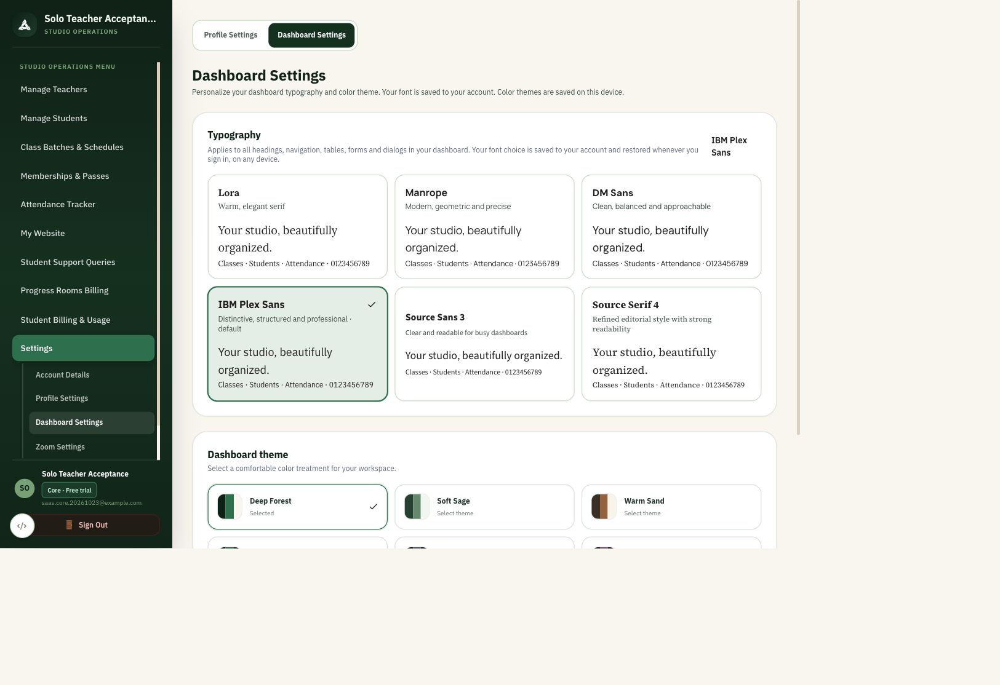
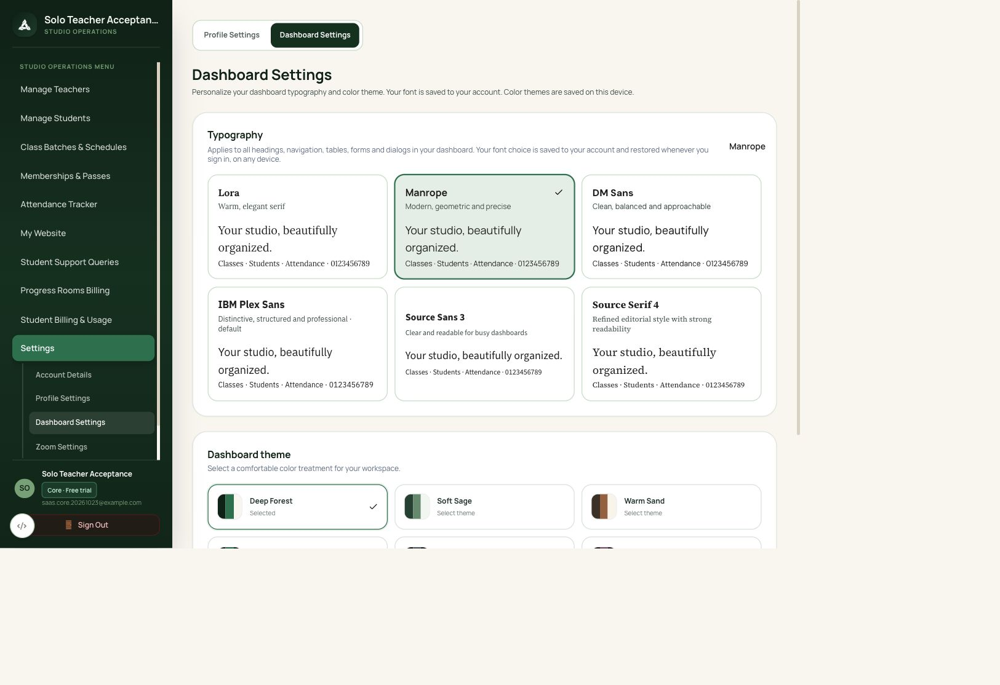

# Dashboard font persistence — 23 October 2026

IBM Plex Sans is the default across owner, teacher, superadmin and student dashboards. Each user's chosen font is stored in `users.dashboard_font`, independently of studio and browser storage. Authenticated `GET/PATCH /api/v1/auth/me/preferences` reads and writes only the signed-in user's preference. The dashboard loads that preference before showing its content, including headings, menus, forms and dialogs. Saving failures restore the previous font and show an error.

Migration `029_dashboard_font` follows `028_usage_pricing_region` and defaults existing and new users to `ibm-plex`. Apply this migration before deploying the updated API. The running isolated local test database has the column applied; no production database was changed. Old browser-only font keys are no longer authoritative.

Verified:
- Browser: IBM Plex Sans selected by default.
- Browser: selected Manrope; direct database query confirmed `users.dashboard_font = 'manrope'`.
- Browser: signed out, signed back in; Manrope remained selected. Computed heading font was `__Manrope_f524cf, __Manrope_Fallback_f524cf`.
- Local preview reset to IBM Plex Sans after testing.
- API: default, persistence, separate user preferences, invalid font rejection, unauthenticated rejection, and student/teacher access.
- Migration: an existing user receives the default; downgrade preserves the user row.
- Font tests: 2 passed. Final combined font + SaaS run: 26 passed.
- Web typecheck and lint passed (existing hook/image warnings).

All changes are local on `dev`; nothing pushed.

