# Subscription flow acceptance — 23 October 2026

Changes are local on `dev`. No pushes or deployments. Existing uncommitted changes were preserved.

## Results

| Check | Result |
| --- | --- |
| Landing Buy Now → selected Studio registration | Browser PASS |
| Starter, Core and Studio registration → OTP verification → selected plan retained | API PASS, synthetic accounts in isolated SQLite database |
| Owner password login → onboarding and plan badge | Browser PASS |
| Paid-plan sign-in continuation → Billing | Browser PASS for Core; fixed lost destination and incorrect student role on return-to-registration links |
| Billing refresh during incomplete onboarding | Browser PASS after fixing an onboarding redirect and missing allowed tab |
| Trial day 28 | Warning dialog and persistent deadline banner; operational API HTTP 200 |
| Trial day 30 and day 31 | Grace state; operational API HTTP 200 |
| Trial day 33 | Restricted; operational API HTTP 402; Billing and Settings HTTP 200 |
| Paid coverage | Active badge and operational menu restored (simulated entitlement) |
| Paid expiry +1 day | Renewal grace; operational API HTTP 200 |
| Paid expiry +3 days | Restricted; operational API HTTP 402; Billing and Settings HTTP 200 |
| Calendar-month billing | Jan 31 → Feb 28 (Feb 29 in leap year), Mar 31 → Apr 30, Jul 31 → Aug 31; anchor restored in subsequent month |
| Exact deadline | Warning two days before expiry; grace includes last second before expiry +3 days; restriction starts exactly at deadline |
| Owner creates teacher → teacher password login | API and browser PASS; same studio plan shown; owner-only Billing API returns 403 |
| Teacher in expired studio | Browser PASS; only Settings shown, expired plan badge and contact-owner instruction |
| Studio quote | Browser PASS: ₹3,999 + ₹719.82 GST = ₹4,718.82; no customer platform fee |
| Changed/tampered checkout price, duplicate fulfillment, provider timeout, signed webhook recovery | Automated tests PASS with provider stubs |

## Fixes

- Paid subscriptions now receive a two-day expiry warning and three-day renewal grace period, matching the trial grace behavior.
- Staff access response includes the actual plan name and slug. A menu badge beneath the user name shows the plan plus Free trial, Paid, Trial grace, Renewal grace, or Expired. Owners can click it to open Billing; teachers go to Settings.
- Paid-plan registration and sign-in preserve Billing as the destination. Plan intent and studio role survive switching between registration and sign-in.
- Billing stays open on refresh even when studio setup is incomplete.

## Validation and limits

- Final billing suite: **43 passed** (`test_saas_billing.py`, `test_platform_billing.py`, `test_billing_and_budgets.py`). Includes added paid month-end and HTTP enforcement regressions.
- Earlier SaaS + account-role run: **29 passed**. A broader combined run later produced **47 passed, 1 failed** because tests share a session database and attempt a second unique SUPER_ADMIN row; this unrelated fixture-isolation failure was not changed.
- Final web TypeScript check passed. Lint passed with existing hook/image warnings.
- Fresh account creation and OTP verification were exercised through the real local HTTP API; browser coverage begins with plan selection/registration display and password login, rather than submitting the registration form.
- All lifecycle screenshots use controlled subscription timestamps in a disposable database, not a change to the machine clock or real customer records. The paid-state screenshot is a simulated entitlement, not proof of a Razorpay payment. Provider verification is covered with stubs.
- Real Razorpay checkout remains **blocked by missing non-mock test credentials and webhook setup**. The UI truthfully disables payment; no transaction was made.
- Expiry enforcement was enabled only in the isolated test server. The existing default remains `SAAS_ACCESS_ENFORCEMENT_ENABLED=false`; deployments will not lock accounts until that rollout flag is enabled. Legacy unmanaged accounts remain exempt.
- Trial length is exactly 30 elapsed days, not the calendar month end. Paid periods follow calendar-month anchors and can contain 28, 29, 30, or 31 days.

Raw local HTTP boundary checks: [api-boundaries.jsonl](api-boundaries.jsonl).

## Screenshots

### 01 selected studio registration

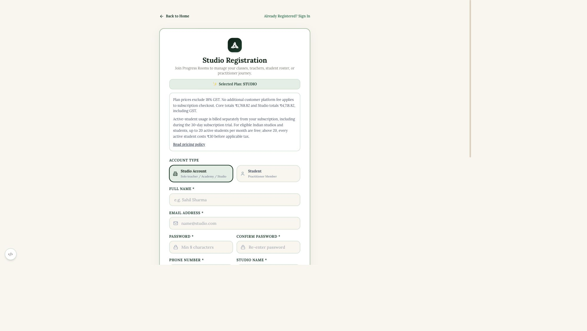

### 02 first login plan badge

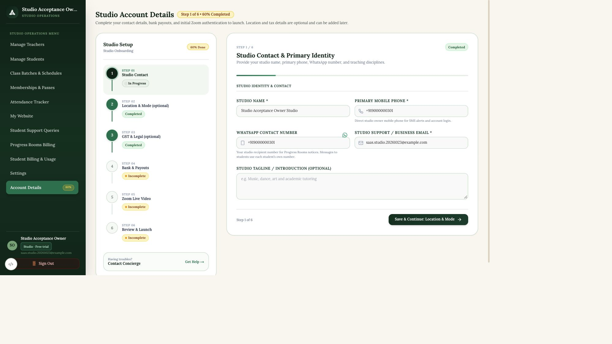

### 03 day28 warning dialog

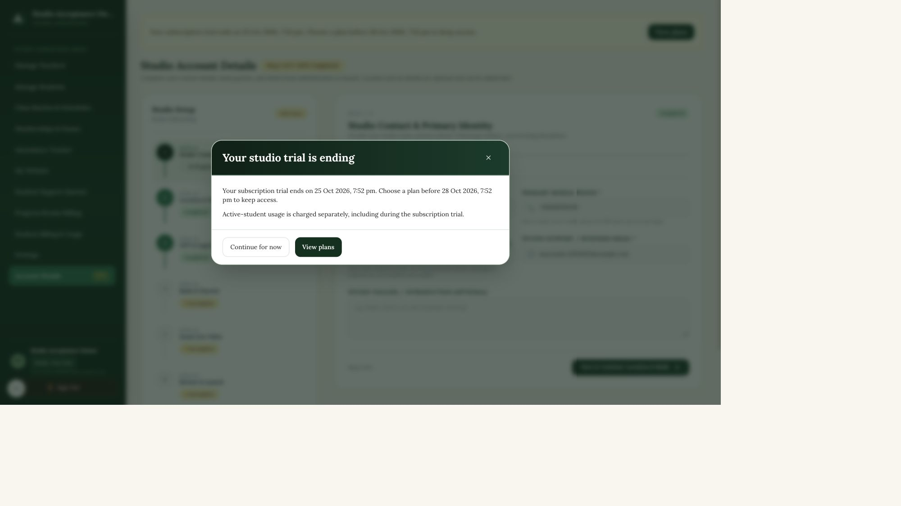

### 04 day28 billing and menu

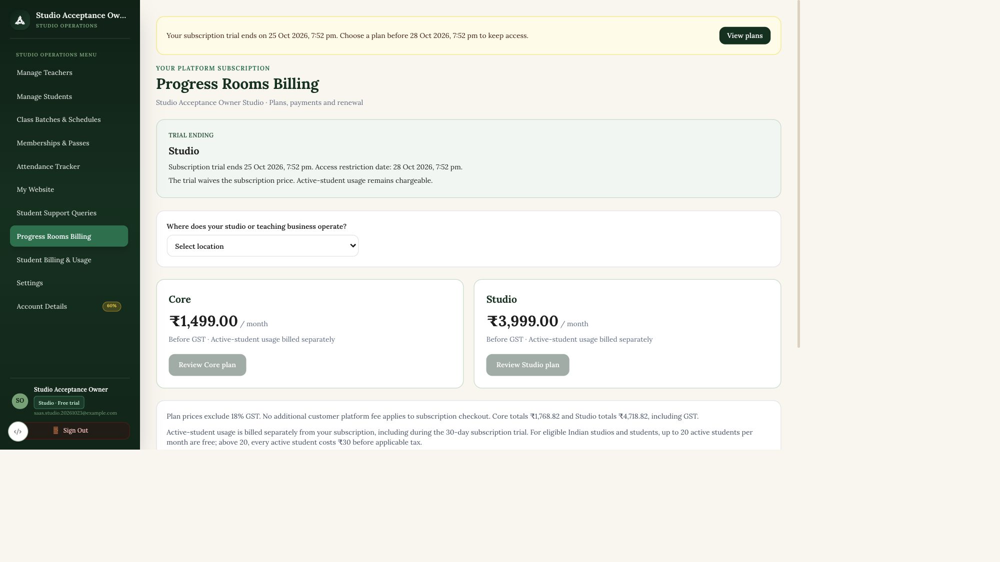

### 05 studio price review

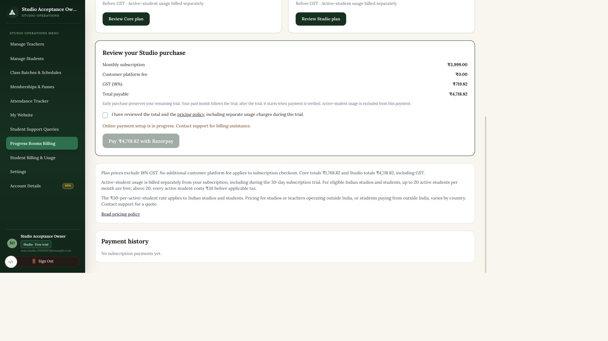

### 06 day30 trial grace

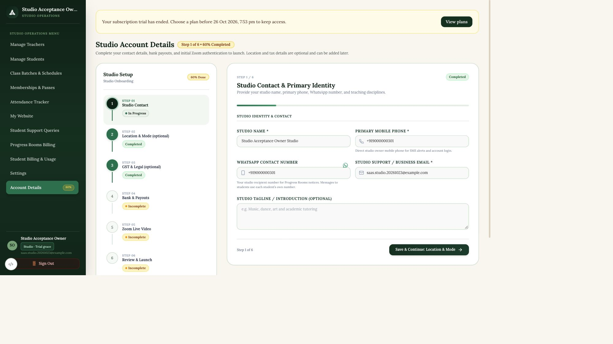

### 07 day31 grace billing

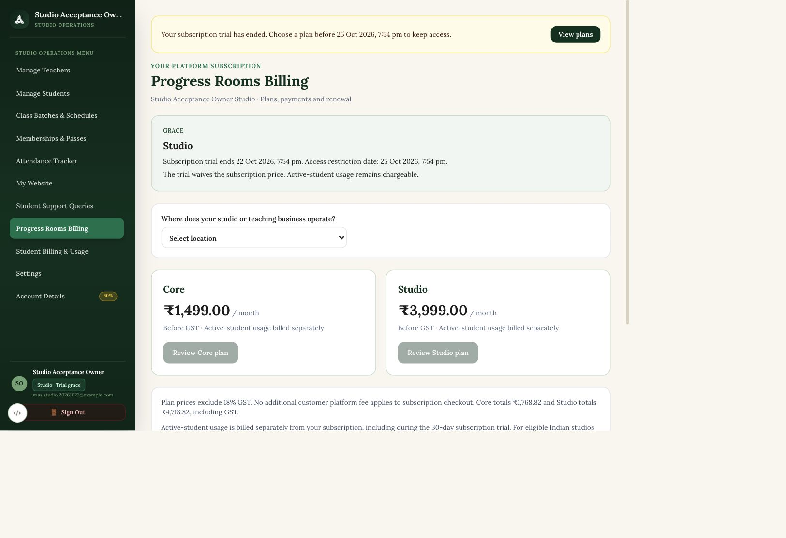

### 08 day33 restricted

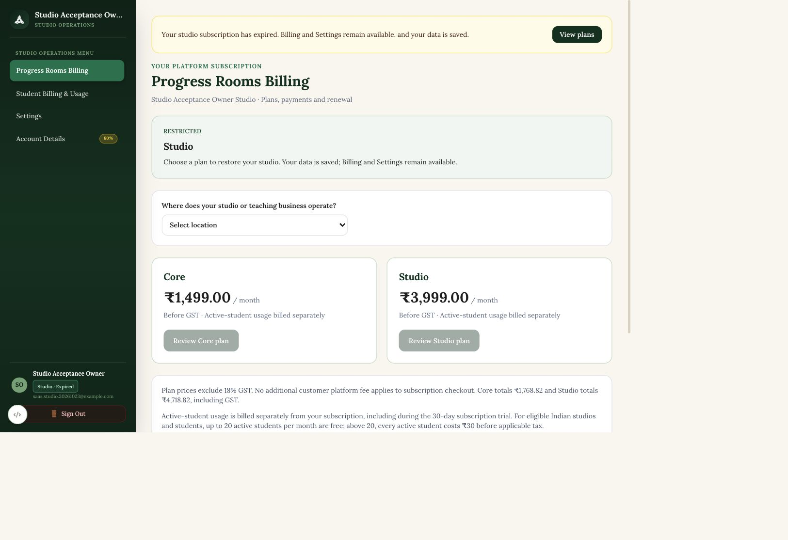

### 09 paid plan restored

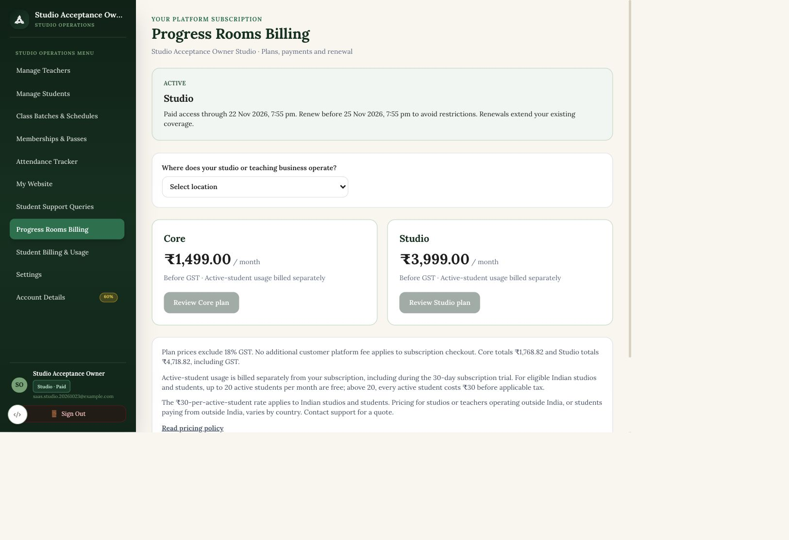

### 10 paid renewal grace

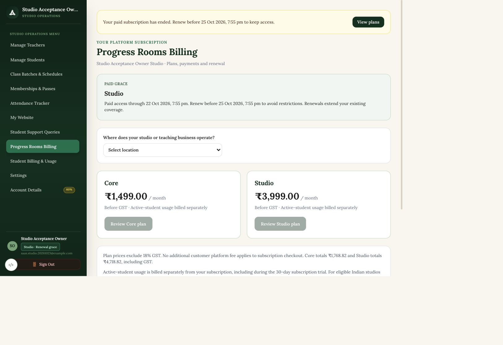

### 11 teacher expired studio

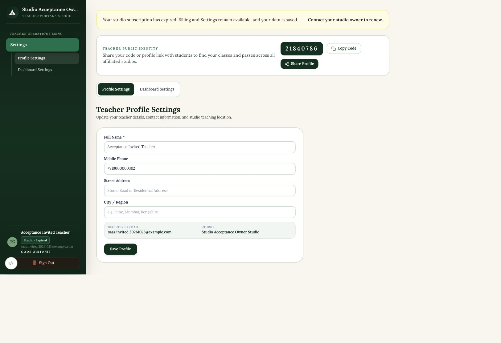

### 12 core solo teacher billing

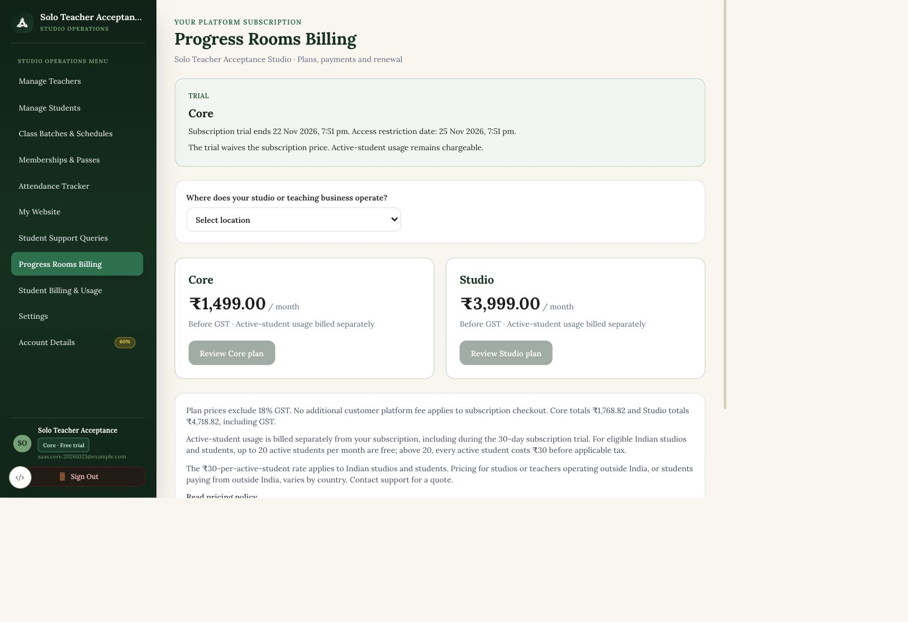

