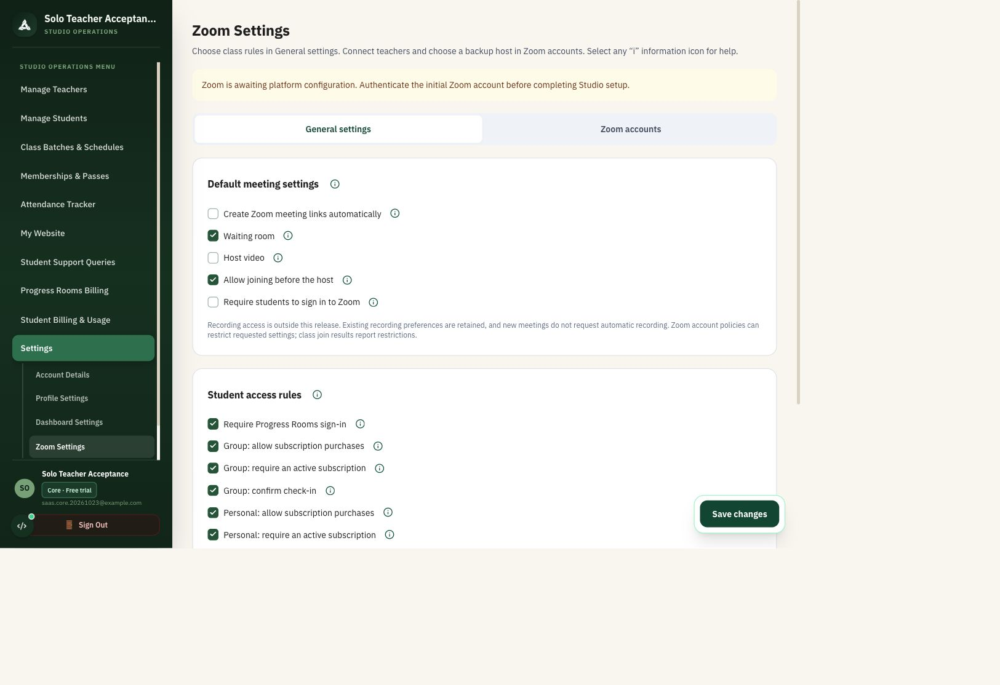
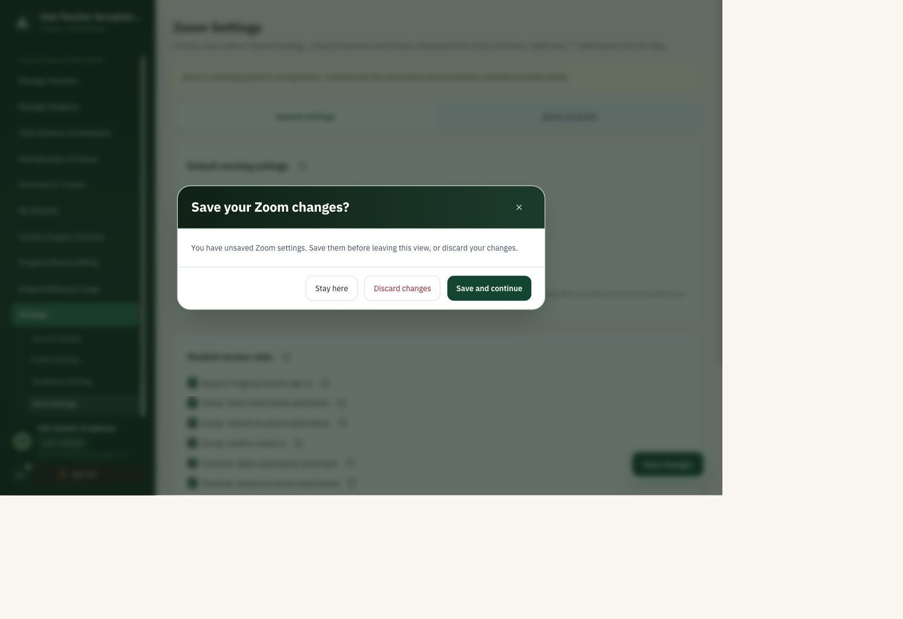
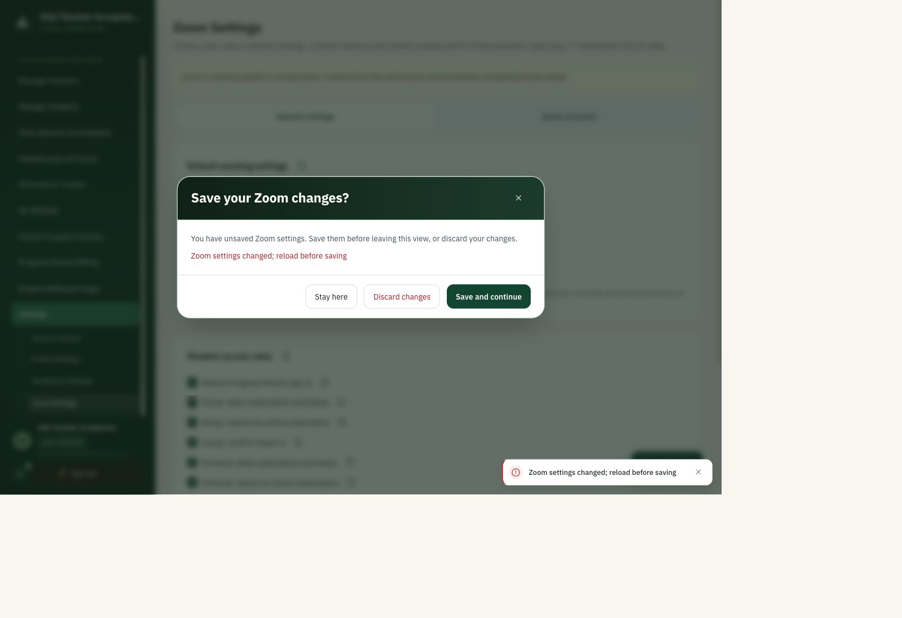

# Zoom pending-change navigation — 23 October 2026

- Removed the static Save all changes panel.
- Floating bottom-right Save changes appears only when general defaults or studio host choices differ from the saved values. Reverting edits hides it again.
- Leaving through Zoom tabs, sidebar routes, Account Details, attendance, sign-out, studio switching, or same-tab links offers Save and continue, Discard changes, and Stay here.
- Browser refresh/close uses the browser's native unsaved-change warning. Back/forward navigation is also guarded.
- Successful save clears pending changes. Failed saves retain edits and block navigation; the error is shown inside the prompt.
- Account connection refreshes retain pending draft fields; changes to unrelated server settings are preserved.

Browser checks on the isolated local test account:
1. Clean view: no floating save.
2. Host video edit: floating save appears.
3. Zoom accounts tab: confirmation appears; Stay retains General settings and edits.
4. Manage Teachers: confirmation appears; Discard navigates and re-entry restores the original server value.
5. Save and continue: saves Host video, switches to Zoom accounts, hides floating save; switching back retains saved value.
6. Direct floating save: succeeds and hides the button; original Host video value restored after testing.
7. Deliberately advanced the disposable database's settings version to simulate a concurrent edit. Save and continue displayed “Zoom settings changed; reload before saving” and retained both the prompt and current route. Discard then navigated to Manage Students.

Web typecheck and lint passed, with existing unrelated hook/image warnings. No branch pushes or deployments.

